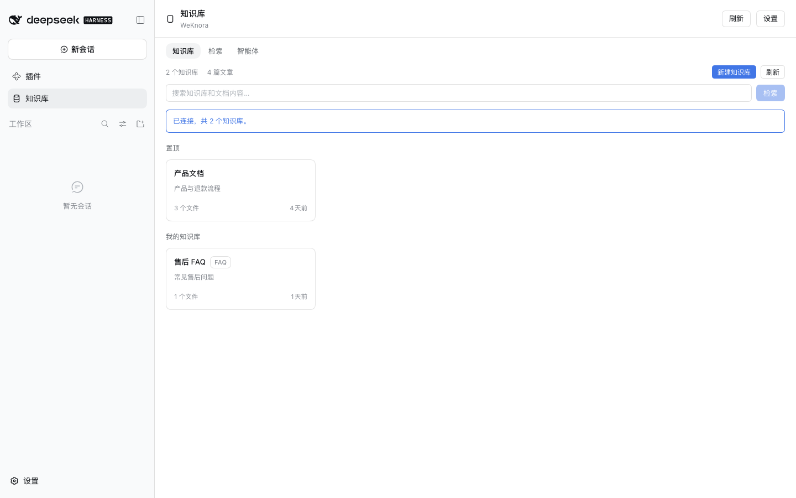
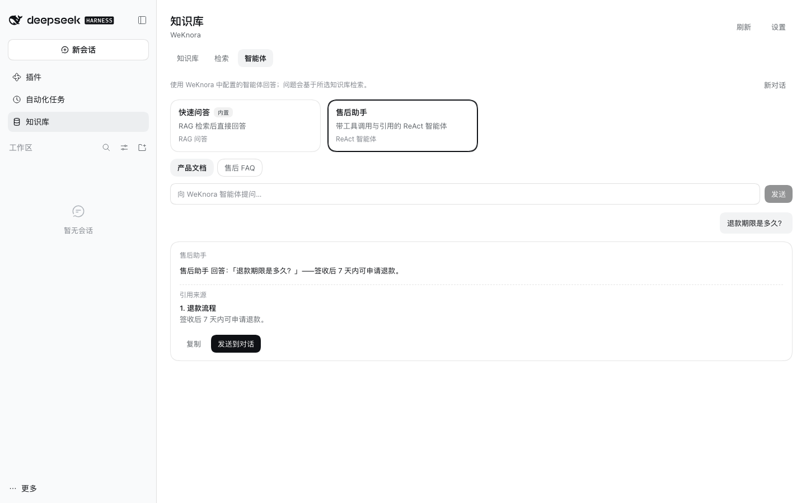
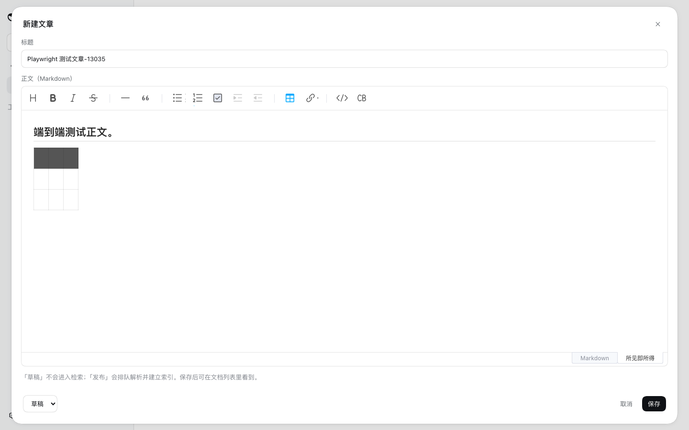
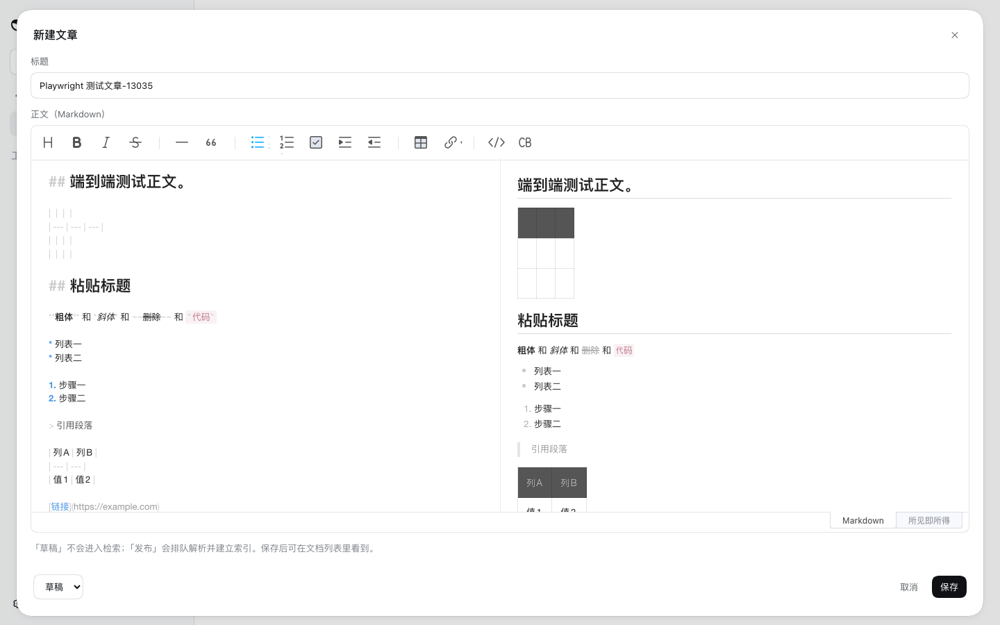
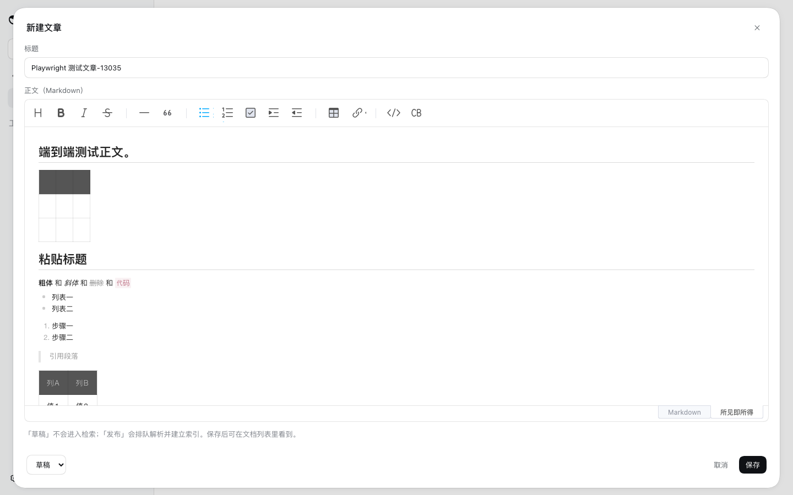
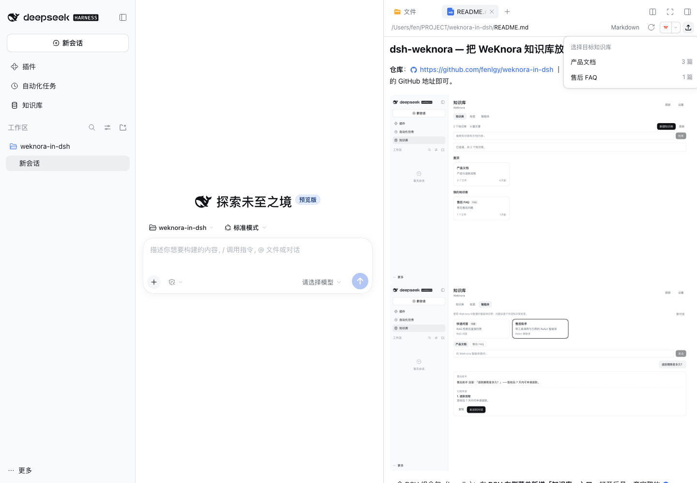
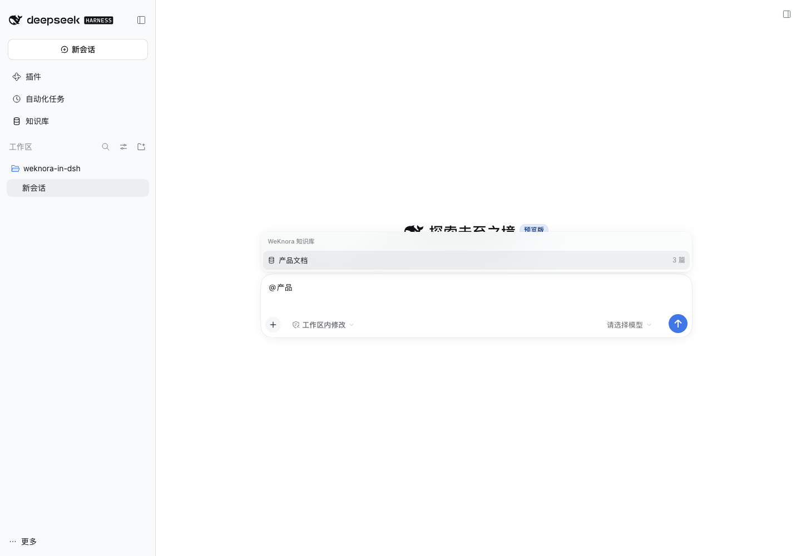
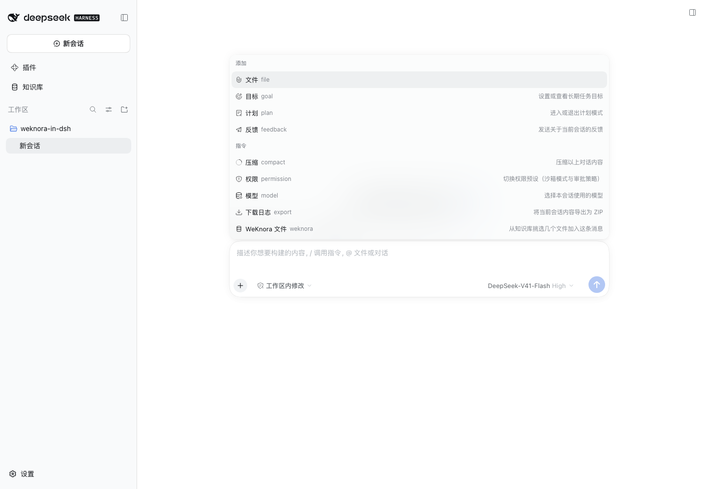
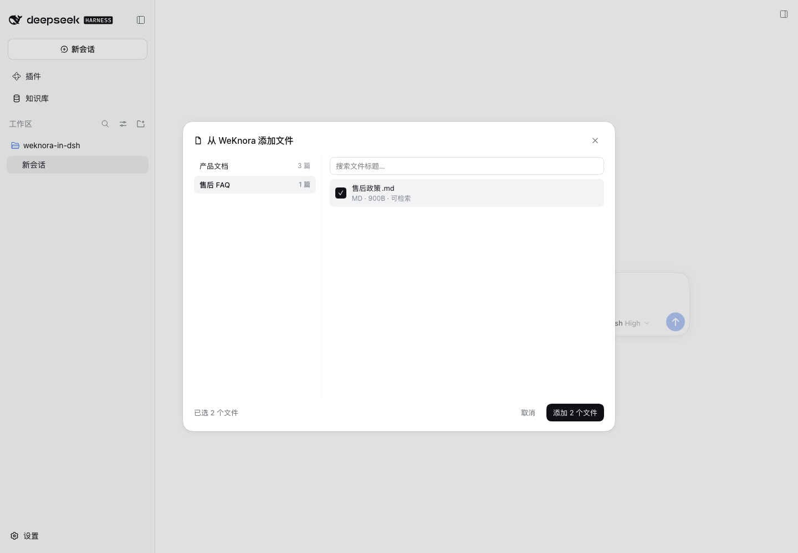

# dsh-weknora — 把 WeKnora 知识库放进 DeepSeek Harness

**仓库**：https://github.com/fenlgy/weknora-in-dsh ｜
**安装**：DSH「插件 → 添加插件」里填上面的 GitHub 地址即可。




一个 DSH 组合包（bundle）：在 **DSH 左侧菜单新增「知识库」入口**，打开后是一套完整的
[WeKnora](https://github.com/Tencent/WeKnora) 知识库管理面板——浏览知识库、管理文章（上传 / 导入 /
撰写 / 编辑 / 重新解析 / 删除）、查看解析分块并直接编辑、语义检索，以及**使用 WeKnora 里配置好的
智能体**进行带引用的问答。同一份配置还会注册成 DSH Agent 的四个工具，让 DSH 里的对话可以直接
检索和引用你的知识库。

```
左侧菜单                       主区域
┌──────────────┐   ┌────────────────────────────────────────────────┐
│ 新会话        │   │ 知识库  WeKnora                [刷新] [设置]      │
│ 插件          │   ├────────────────────────────────────────────────┤
│ ▶ 知识库 ◀────┼──▶│ (知识库) (检索) (智能体)                          │
│ 工作区        │   │ 2 个知识库 · 4 篇文章      [+ 新建知识库]        │
│              │   │ ┌────────────┐ ┌────────────┐                 │
│              │   │ │ 产品文档    │ │ 售后 FAQ    │                 │
│              │   │ └────────────┘ └────────────┘                 │
└──────────────┘   └────────────────────────────────────────────────┘
```

---

## 1. 能力一览

### 左侧「知识库」面板

| 区域 | 能力 |
| --- | --- |
| 知识库 | 列表 / 置顶分组 / 名称与文档搜索、新建知识库（文档 / FAQ / Wiki）、删除知识库、卡片统计 |
| 文章管理 | 上传文件/文件夹（多选、multipart 直传；也可**把文件或整个文件夹拖进知识库**，文件夹保留相对路径）、从 URL 导入、手工撰写 Markdown（**内置 Toast UI Editor：格式工具栏、所见即所得 / Markdown 源码双模式、可视化表格编辑、中文界面**）、编辑手工文章、删除、重新解析、分页 |
| 文档详情 | 解析分块按 Markdown 渲染、**编辑分块**（乐观并发 `expected_revision`）、原文件预览（PDF / 图片 / 文本编码嗅探）、复制 / 发送到对话 |
| 检索 | 多知识库范围选择、`POST /knowledge-search` 命中片段与分数、rerank 诊断 |
| 智能体 | 列出 WeKnora 中配置的智能体、选择范围、流式（SSE）提问、工具调用计数、引用来源、复制 / 发送到对话、多轮会话与「新对话」 |
| 会话引用 | 在任意新会话的输入框输入 `@`，菜单里多出「WeKnora 知识库」分组；选中后插入知识库 chip，当前这轮的工具调用自动只检索该库 |
| 会话文件 | 输入框「+」（添加文件或调用指令）菜单新增「WeKnora 文件」：打开多选对话框，跨知识库勾选任意几篇文档，插入文件 chip；当前这轮的工具调用自动只检索这几篇文档 |
| 设置 | 服务地址 / API Key / 租户 ID / 访问令牌 / 默认智能体、「测试连接」，保存在本机且**不会随对话发给模型** |

> 新建/编辑文章由 **Toast UI Editor** 驱动（NHN 开源、MIT，专用 Markdown 编辑器里 GitHub 星标最高，
> npm 周下载约 13.5 万）：工具栏一键插入标题、粗体、列表、链接、代码和表格；默认「所见即所得」，
> **粘贴 Markdown 会自动转成排版，手输 `# `、`- `、`1. `、`> ` 以及 `**粗体**`、`*斜体*`、`~~删除~~`、`` `代码` `` 也会自动成型**；
> 表格可以直接点选行列、增删行列，右下角可切换成 Markdown 源码；中文界面，支持快捷键。
> 编辑弹窗接近全屏，编辑区高度随窗口自适应。草稿不进入检索，发布后才排队解析。
>
> 编辑器脚本与样式已离线内置在 `vendor/toastui/`，由宿主侧同源提供，不依赖 CDN；不构建插件也能直接安装使用。







### DSH Agent 工具

同一次配置注册四个模型可调用工具，DSH 里任何会话都能用它们：

| 工具 | 作用 |
| --- | --- |
| `weknora_list_knowledge_bases` | 列出凭据可见的知识库（id / 名称 / 文档数） |
| `weknora_search` | 混合检索，返回原文片段与 `knowledge_id`，用于让模型基于证据回答 |
| `weknora_read_document` | 按顺序拼回一篇文档的分块，支持翻页 |
| `weknora_ask` | 交给 **WeKnora 中配置的智能体**回答，返回答案、引用与可续聊的 `session_id` |

工具名可用 `toolPrefix` 改名（同时挂两套部署时有用）。会话里的 `@` 知识库 mention 会自动成为本轮
`weknora_search` / `weknora_ask` 的检索范围（宿主侧解析，无需模型自己传 id）；从「+」菜单加入的
文件 chip 会进一步把范围收窄到所选文档。

### 工作区文件快捷上传

在 DSH 右侧栏打开工作区文件预览时，标题栏会多出一个「上传到知识库」按钮；不支持预览的文件，空态里也有同款按钮：

1. 点按钮**只展开知识库下拉菜单**，不会直接上传；
2. 选中目标库后，当前文件经 DSH 已认证的 `/api/file` 读取，再由插件代理以 multipart 上传；
3. 文件位于当前 session 工作目录内时保留相对路径（如 `docs/a.md`），否则只使用文件名；
4. 成功后提示并自动关闭菜单；已打开的知识库面板会收到事件并刷新。

只读取当前预览的这个文件，**工作区绝对路径不会发给 WeKnora**。受 DSH `/api/file` 默认 20 MiB 读取上限约束。



### 在会话里 @ 引用知识库

在任意会话（包括新建会话）的输入框键入 `@`，候选菜单会同时列出文件/会话和 **WeKnora 知识库**：

1. 继续输入知识库名称可过滤，例如 `@产品`；
2. 选中后插入一个知识库 chip，草稿里保存为规范 mention `@[产品文档](weknora:kb/<id>)`；
3. 发送后，宿主工具会自动读取**本轮最新用户消息**里的 mention，把 `weknora_search` /
   `weknora_ask` 的检索范围限制到该知识库（显式传入的 `knowledge_base_ids` 优先）；
4. 提到多个库时按 mention 顺序全部生效；下一轮没有 mention 就恢复默认范围。



> 菜单只显示候选，不影响模型请求；真正的范围限制发生在宿主工具执行时，绝对路径和 Key 都不会进入提示词。

### 从「+」菜单添加 WeKnora 文件

输入框左侧的「**+**」（添加文件或调用指令）菜单里多出一行 **WeKnora 文件**：



1. 点击后打开**多选对话框**：左侧切换知识库，右侧勾选文件（可搜索标题、解析状态、大小）；
2. 勾选会跨知识库保留，右下角显示「已选 N 个文件」，确认后一次性插入 N 个文件 chip；
3. chip 在草稿里保存为规范 mention `@[文件名](weknora:doc/<kb>/<doc>)`，发送时由宿主解析；
   新版 DSH（0.2.1+）刷新或切换会话后仍能恢复成 chip，0.2.0 会把草稿还原成同样的 mention 文本
   （不影响发送与检索范围）；
4. 发送后宿主工具把本轮检索范围**限定到这几篇文档**：`weknora_search` / `weknora_ask` 会带上
   `knowledge_ids`，与 `@` 知识库 mention 可以同时使用（知识库范围取并集，文档范围进一步收窄）。



> 解析中的文档也可以先加入，WeKnora 完成解析后即可检索到；插入不改变模型请求，直到你发送这条消息。

---

## 2. 安装

代码仓库：**https://github.com/fenlgy/weknora-in-dsh**

### 方式 A：DSH 图形界面（推荐）

1. 打开 DeepSeek Harness → 左侧「**插件**」→「**添加插件**」；
2. 安装源填 GitHub 仓库地址：

   ```
   https://github.com/fenlgy/weknora-in-dsh
   ```

3. 确认安装。安装器会通过 pnpm 拉取仓库，并把它加入当前 profile 的
   `dsh.profile.bundles`；
4. **刷新页面**（macOS 上 `Cmd+R`），左侧出现「知识库」入口。

desktop profile 由桌面应用托管，请用这个图形入口安装/卸载/更新。

### 方式 B：命令行（非 desktop profile）

```sh
dsh plugin --profile web add github:fenlgy/weknora-in-dsh
# 或者
dsh plugin --profile web add https://github.com/fenlgy/weknora-in-dsh
```

### 本地开发

```sh
dsh plugin --profile web add /path/to/weknora-in-dsh
```

改 `client.js` 后刷新页面即可；改 `index.js`（宿主侧）需要重启 DSH。

> 说明：本包用 `dsh.bundle.patch` 声明组合包、用 `dsh.client` 声明浏览器侧 bundle。
> `client.js` 是纯 JS（不是构建产物），安装时不需要构建。
>
> 本项目目前没有发布到 npm，从 GitHub 安装得到的是仓库快照。**更新时先在「插件」页卸载再安装**
> （非官方插件没有内置的“更新”按钮）。
>
> DSH 应用自身升级后，profile 的 `dsh.profile.bundles` 可能被升级流程重置，表现为「知识库」
> 入口和 `/weknora` 路由一起消失（此时面板里保存设置会失败、甚至点不到面板）。去「插件」页
> 重新安装一次本插件即可恢复。

---

## 3. 配置

首次打开面板会直接显示「设置」。填写后保存，配置写到：

```
$DSH_HOME/weknora/config.json     # 默认 ~/.dsh/weknora/config.json，权限 0600
```

面板、宿主代理和 Agent 工具**共用这一份配置**，因此只需要配一次。按优先级：

1. 面板保存的设置（上面的文件）；
2. 环境变量 `WEKNORA_BASE_URL` / `WEKNORA_API_KEY` / `WEKNORA_TENANT_ID` /
   `WEKNORA_AGENT_ID` / `WEKNORA_KNOWLEDGE_BASE_IDS` / `WEKNORA_TOOL_PREFIX`；
3. profile 的 `cordis.patch.yml` 里传给插件的 `config`。

字段：

| 字段 | 说明 |
| --- | --- |
| 服务地址 | WeKnora 部署地址，例如 `http://192.168.1.20:8080`；可带反向代理前缀，误带 `/api/v1` 会自动去掉 |
| API Key | `X-API-Key`。读需要 `retrieve`；写文章/编辑分块需要 `ingest`；`weknora_ask` 需要 `chat` |
| 租户 ID | 只填**数字空间 ID**（如 `7`）；空间级 Key 留空，平台级 Key 才需要 |
| 访问令牌 | 可选，JWT 替代 API Key（`Authorization: Bearer`） |
| 默认智能体 | 可选，`weknora_ask` 与智能体面板的默认选中项；留空则用面板里选的智能体 |

> 保存结果会明确区分两件事：看到「设置已保存并已连接」说明写入成功且连上了新部署；看到
> 「设置已保存到本机，但连接失败」说明**已经保存**，问题在地址、网络、证书或 Key 权限；只有
> 连保存提示都没有时，才是表单校验没通过（服务地址必须是 `http(s)://…`，租户 ID 只能是数字空间 ID）。
> 「测试连接」使用已保存的设置，改完表单请先保存再测试。

profile 级兜底写法：

```yaml
- id: weknora
  config:
    baseUrl: http://192.168.1.20:8080
    apiKey: !!js process.env.WEKNORA_API_KEY
    tenantId: '7'
    agentId: agent-1
    knowledgeBaseIds: [kb-123]
    toolPrefix: weknora
```

---

## 4. 架构

本包分两半，浏览器永远不直接跨域请求 WeKnora：

- **`index.js`（宿主侧，Node）**
  - 在 DSH web server 上认领前缀路由 `/weknora`，把 `/weknora/<path>` 转发到
    `服务地址 + /<path>`，在**服务端**补上 `X-API-Key` / `Authorization` / `X-Tenant-ID`；
  - 识别 `text/event-stream` 并**逐块透传**，所以智能体回答是流式的；
  - 本地路由：`GET/PUT /weknora/__config`（设置）、`POST /weknora/__test`（测试连接）、
    `GET /weknora/__vendor/toastui-3.2.2/...`（离线内置的编辑器脚本、样式与中文语言包）；
  - 通过 `ctx.tools.register()` 注册四个 Agent 工具，工具执行时读取同一份设置。
- **`client.js`（浏览器侧，纯 JS）**
  - 向侧边栏 `sidebar.panellist` 注册「知识库」入口，并向 `main` 注册同 id 的面板；
  - 向 `ctx.commandUi` 注册「+」菜单里的 **WeKnora 文件** 动作，向 `conversation.input.overlay`
    注册多选对话框；选中的文件以引用 chip 插入 composer，宿主按
    `@[name](weknora:doc/<kb>/<doc>)` 解析本轮范围；
  - 所有网络调用都走同源 `/weknora` 前缀，页面里没有 API Key；
  - 打开新建/编辑文章弹窗时按需加载内置的 Toast UI Editor（脚本、样式、中文语言包均来自宿主侧的同源路由，
    加载失败会退回纯文本编辑框，保存能力不受影响）。

安全边界：

- API Key 只存在于宿主进程和 `0600` 配置文件；`GET /__config` 只返回 `hasApiKey` / `hasToken` 标志；
- 允许的逐请求覆盖头：`x-weknora-base` / `x-weknora-key` / `x-weknora-token` / `x-weknora-tenant`；
- 租户 ID 在面板保存前、宿主转发前都会校验，避免 WeKnora 返回难懂的 `Invalid X-Tenant-ID header`；
- 分块等只读 Markdown 由自带渲染器输出 React 节点（不使用 `dangerouslySetInnerHTML`），链接只放行
  `http` / `https` / `mailto`，图片只显示 alt 文本；文章编辑器使用 Toast UI Editor 自带的
  DOMPurify 清洗管线。

---

## 5. 开发与测试

```sh
# 单元 + 集成测试（宿主路由、工具、浏览器 bundle 的 SSR 渲染）
node --test test/*.test.mjs

# 端到端：mock WeKnora + 隔离的 DSH profile + 无头 Chromium
node test/e2e/mock-weknora.mjs 19090 &
DSH_HOME=$PWD/.dsh-test node ~/.dsh/profiles/node_modules/@deepseek-ai/dsh/lib/bin.js \
  --profile weknora-test --port 19402 --no-open
python3 test/e2e/panel.py "http://127.0.0.1:19402/?token=<printed-token>"

# 工作区文件快捷上传（应用需带 SSH_CONNECTION 启动，才会用内置目录选择器）
SSH_CONNECTION="127.0.0.1 50000 127.0.0.1 22" DSH_HOME=$PWD/.dsh-test \
  node ~/.dsh/profiles/node_modules/@deepseek-ai/dsh/lib/bin.js \
  --profile weknora-test --port 19403 --no-open
python3 test/e2e/workspace_upload.py "http://127.0.0.1:19403/?token=<printed-token>"

# 「+」菜单选择 WeKnora 文件（多选、跨知识库）
python3 test/e2e/weknora_files.py "http://127.0.0.1:19402/?token=<printed-token>"
```

`test/e2e/panel.py` 会验证：侧边栏入口、设置「测试连接」、知识库列表与新建/删除、文章表格、
新建文章（等待 Toast UI Editor 加载、所见即所得输入、可视化插入表格、切换 Markdown 源码、保存/编辑回填）、
重新解析、删除、multipart 上传、**拖拽上传（含拖拽悬浮层）**、**文件夹选择上传（保留子目录）**、
WeKnora 智能体流式问答与引用、检索命中，并截图到 `test/e2e/screenshots/`。

编辑器资源是预构建后提交到 `vendor/toastui/` 的，普通安装不需要构建。维护时改动版本或重新打包：

```sh
npm install          # 安装 devDependencies（esbuild + @toast-ui/editor）
npm run build:vendor # 重新生成 vendor/toastui/ 下的脚本、样式和语言包
```

`test/e2e/workspace_upload.py` 会创建/打开工作区文件预览，断言快捷按钮、知识库下拉菜单，并把
`README.md` 真正上传到 mock 知识库后回面板核对文档行。

`test/e2e/mention.py` 在新建会话的输入框里输入 `@产品`，断言菜单过滤出 mock 知识库、选中后出现
知识库 chip，且草稿序列化为宿主可解析的 `@[产品文档](weknora:kb/<id>)`。

`test/e2e/weknora_files.py` 驱动「+」菜单新增的 **WeKnora 文件**：打开多选对话框、跨文件勾选
两篇 mock 文档，断言 composer 里出现两个 `weknora-doc` chip、草稿持久化出
`@[文件名](weknora:doc/<kb>/<doc>)`。截图落在 `test/e2e/screenshots/10..12-picker-*.png`。

宿主半边的测试覆盖：设置落盘与权限、非法设置拒绝、凭据注入、multipart 原样转发、SSE 透传、
文档 mention 解析（编码 / 去重 / 与知识库 mention 共存 / 只读最新用户消息），以及四个工具对真实
HTTP mock 的执行与渲染——包括 `weknora_search` / `weknora_ask` 在带文件 chip 时把
`knowledge_ids` 放进请求体。

`test/e2e/desktop.py` 则用来检查**正在运行的桌面应用**：它复用桌面窗口自己的登录 Cookie，
在无头浏览器里加载 `127.0.0.1:19387`，确认侧边栏入口、真实知识库与真实智能体列表都渲染出来
（只读，不会改动 WeKnora 数据）。Cookie 可用 `sqlite3` 从
`~/Library/Application Support/@deepseek-ai/dsh-desktop/Cookies` 读出后作为参数传入。

---

## 6. 兼容性

- 面向 DSH `0.2.0-rc.2` 开发与验证（`sidebar.panellist` / `main` 插槽、`ctx.tools.register()`）。
  「+」菜单文件选择器还额外在桌面端 `0.2.1-rc.3` 上验证过（`ctx.commandUi` 动作 +
  `conversation.input.overlay` 浮层 + `SessionInput.insertReference` 插入 chip）。
- 引用 chip 的**发送时渲染**依赖 `uiConversation.userText`（0.2.1+）；0.2.0 没有这个 API，
  插件会跳过注册、只保留 `@` 候选与 chip 序列化，发送后的 mention 显示为普通文本。
- 面向 WeKnora `0.7.x` 的 REST 形状开发；接口在小版本间有增删，面板对可选字段都做了回退读取。
- 内置 Toast UI Editor `3.2.2`（MIT，脚本 566 KB / 样式 168 KB，仓库内已提交），无需联网或额外构建。
- 插件自身没有运行时 npm 依赖，只使用 Node 内置模块与浏览器原生 API。

## License

MIT
